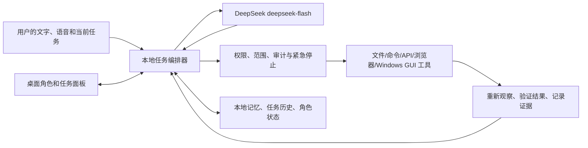

# 桌面常驻智能体：前期调研与产品构想

日期：2026-10-07。范围：Windows 个人电脑、二次元互动实体、DeepSeek V4.1 Flash 在线推理、本地语音和电脑操作。本文件记录立项前的技术选型；实施状态见[阶段计划](./2026-10-07-mvp-plan.md)和项目 README。

## 一、先确定产品定义

目标可以定义为“住在电脑里的个人智能体”：它有可互动的角色形象、持续的对话与记忆、可主动提出帮助，也能在用户授权的任务范围内使用文件、应用、浏览器和命令。角色只是同一智能体的可见身体；任务面板、语音、快捷键和应用插件都是它的其他入口。

“自主意识”可落实为工程上可观察的行为：持续身份、长期目标、基于环境的主动提议、任务执行与复盘、可解释的记忆更新。主观意识目前无法作为可验证的交付承诺。对外应明确区分角色设定、模型推断和已经验证的电脑状态。

产品可以逐步拓展成：

- **陪伴**：待机、注视、表情、触摸反馈、主动搭话、声线与人格；角色状态真实反映“听、想、说、操作、成功、受阻”。
- **电脑协作**：跨应用检索、整理资料、写作、编码、安装配置、排查问题、重复事务自动化；每个任务有计划、进度、证据和可撤销记录。
- **情境感知**：在授权后感知当前窗口、选中文本、剪贴板、通知、任务日程或游戏画面，适时提出建议；可按应用和时间关闭感知。
- **娱乐与创作**：陪玩、观战解说、直播角色、游戏中的辅助操作、角色故事和多角色协作。游戏操作应单独验证，不能由桌面办公能力推定。
- **跨设备延伸**：同一身份以后可以进入 Obsidian、浏览器、手机通知或远程任务面板，但电脑端仍保留本地权限、任务历史和紧急停止。

## 二、本机可复用的现状

- 调研时 `D:\DesktopPetProject` 为空目录，没有可直接接续的代码；此后已开始 M0 实现。
- Obsidian 中的 Claudian 插件是 `realclaudian` 2.2.4，安装于 `D:\Obsidian Repository\431\.obsidian\plugins\realclaudian`。它的本地 `data.json` 为 `{}`；[Claudian 官方仓库](https://github.com/YishenTu/claudian)说明 MCP 使用所选编码智能体自己的 CLI 配置。
- Claude Code 全局配置 `C:\Users\27926\.claude.json` 注册了 `windows-mcp`，以 `C:\Users\27926\.local\bin\windows-mcp.exe serve` 的 stdio 服务接入。`uv tool list` 显示本地安装 `windows-mcp v0.8.5`；可执行文件的 `--help` 已通过。配置中的匿名遥测设为 `false`，UI 树节点上限为 `3000`。本轮只读配置，**没有启动 MCP 服务或试操作桌面**，因此尚未证明 Claudian 会话中的实时连接状态。
- 本机服务对应 [CursorTouch/Windows-MCP](https://github.com/CursorTouch/Windows-MCP) 的安装形式。该 MIT 项目提供窗口/UI 树、截图、鼠标键盘，以及 Shell、进程、剪贴板、注册表等工具；[安全说明](https://github.com/CursorTouch/Windows-MCP/blob/main/SECURITY.md)明确其能力可影响整个系统。适合先做受监督的能力实验，但产品不能把全部工具无差别交给模型。

## 三、模型与执行闭环

[DeepSeek 2026-09-10 公告](https://api-docs.deepseek.com/news/news260910/)和[模型页](https://api-docs.deepseek.com/quick_start/pricing/)确认，V4.1 Flash 的 API 模型名是 `deepseek-flash`；旧 `deepseek-v4-flash` 是兼容别名。它支持视觉输入、工具调用和 Responses API，文档标示 1M 上下文。这里的“本地搭建”建议指本地应用、语音、记忆、权限与执行服务，推理先用在线 API。官方描述模型为 552B 参数 MoE；整套权重在普通个人电脑本地部署不应是首版前提。

[DeepSeek Responses API 文档](https://api-docs.deepseek.com/guides/responses_api/)说明截图可以作为图像输入，模型能提出自定义函数调用；该接口是无状态的，应用要管理多轮历史。它**没有直接替应用操作电脑的内建 `computer_use` 工具**。需要自己实现：

每一步先选结构化接口：文件/API/命令用于可确定的操作，浏览器 DOM 与 Windows UI Automation 用于界面元素，截图加视觉定位作为补充。动作后重新观察并核对目标状态，而不是把“工具调用成功”当作“用户目标完成”。对个人文件和不可逆动作设置任务级范围、预览与确认；角色界面始终能暂停、拒绝下一步或结束任务。权限应分别覆盖文件/命令、GUI、浏览器、外部通信，不能只给一个总开关。

## 四、GitHub 项目候选

| 领域 | 项目 | 借鉴点与首版取舍 |
|---|---|---|
| Windows 现成底座 | [CursorTouch/Windows-MCP](https://github.com/CursorTouch/Windows-MCP)（MIT） | 本机已装。先用于受监督 PoC，限定可用工具和测试目录；其 Shell/注册表/进程能力不应默认开放。 |
| Windows 产品执行层 | [trycua/cua：Cua Driver](https://github.com/trycua/cua)（核心 MIT） | Windows 截图、窗口、无障碍树、键鼠，CLI/MCP/SDK；[权限模式](https://cua.ai/docs/cua-driver/guides/permissions)提供有界任务清单。值得与现有 MCP 实测比较，仓库其他扩展依赖的许可需另查。 |
| Windows UI 架构 | [microsoft/UFO](https://github.com/microsoft/UFO)（MIT） | 借鉴 UI Automation 与应用 API 混用；现成 DeepSeek 示例配置较旧，不能直接照搬。 |
| 视觉 GUI 智能体 | [UI-TARS Desktop](https://github.com/bytedance/UI-TARS-desktop)（Apache-2.0）、[Agent-S](https://github.com/simular-ai/Agent-S)（Apache-2.0） | 对照截图定位、反馈和多步任务策略。Agent-S 需单独 grounding 模型，官方基准成绩不等于本机可靠率；首版暂不叠加第二套主控。 |
| 命令/开发任务 | [Open Interpreter](https://github.com/openinterpreter/openinterpreter)（Apache-2.0）、[OpenHands Agent SDK](https://github.com/OpenHands/software-agent-sdk)（MIT） | 借鉴命令工具、会话、隔离工作区和技能体系；不把它们当 Windows GUI 主控。 |
| 角色整体架构 | [AIRI](https://github.com/moeru-ai/airi)（MIT） | 借鉴角色状态、Live2D/VRM、语音与插件组织；其[电脑操作可行性文档](https://github.com/moeru-ai/airi/blob/main/services/computer-use-mcp/FEASIBILITY.md)说明 Windows 不在 v1 已验证范围。 |
| 语音桌宠交互 | [Open-LLM-VTuber](https://github.com/Open-LLM-VTuber/Open-LLM-VTuber)（主代码 MIT） | 借鉴 Windows 透明桌面窗、拖拽、说话打断、表情和 Agent 插槽；自带美术另有许可，电脑操作层需要另建。 |
| 完整愿景参考 | [Soul of Waifu](https://github.com/jofizcd/Soul-of-Waifu)（GPL-3.0） | 仓库自述具备形象、语音、屏幕/文件/工具和审批，值得研究；本轮未做实机验证，整个 fork 还会引入 GPL 约束。 |
| 角色事件协议 | [Tsuma](https://github.com/Rukafuu/tsuma)（MIT） | 参考“Agent 事件 → 表情/动作”的解耦方式；本身不承担完整任务执行。 |

**初步组合**：一个原创、可替换的角色前端；自己的轻量任务编排器与本地 SQLite 状态；`deepseek-flash`；当前 Windows-MCP 做小范围验证，再比较 Cua Driver 是否更适合产品化；文件/命令执行另建受限工具。这样各层可以独立替换、测试和授权。

## 五、语音：LexVoice 的两条路线

[LexVoice 仓库](https://github.com/Lynn-x/LexVoice)与[许可文件](https://github.com/Lynn-x/LexVoice/blob/main/LICENSE)显示 2.2.0 起开发源码不再公开，现版采用专有许可；2.1.2 及更早 MIT 授权仍有效。适合借鉴产品交互，不直接搬现版代码。[手册](https://www.lexvoice.cn/en/manual)把实时 WebSocket 字幕与 HTTP 分段转写分开；后者保留主录音、时间戳、失败重试，默认五分钟切片偏向会议。

对桌面智能体应区分：

1. **对话模式**：麦克风 → VAD 判断开口/停顿 → 流式或短句 ASR 的 partial/final 字幕 → DeepSeek → 按句生成 TTS → 可打断播放；需要处理宠物自己的声音被麦克风识别的问题。
2. **长录音模式**：持续保存录音 → 定时分段识别 → 时间戳、失败重试和恢复；借鉴 LexVoice，但不能把五分钟切片延迟带进普通对话。

| 部件 | 候选 | 初步判断 |
|---|---|---|
| 本地 ASR/TTS/VAD | [sherpa-onnx](https://github.com/k2-fsa/sherpa-onnx)（Apache-2.0） | 官方提供 Windows 和流式/非流式能力，适合统一语音底座；选定模型权重另核许可。 |
| 片段转写 | [faster-whisper](https://github.com/SYSTRAN/faster-whisper)（MIT） | 适合录音和短句；不是原生连续流式字幕。 |
| 中文流式识别 | [FunASR](https://github.com/modelscope/FunASR)（工具包 MIT） | Paraformer/WebSocket 可对照测试；[模型权重许可](https://github.com/modelscope/FunASR/blob/main/MODEL_LICENSE)单独核查。 |
| 讲话起止 | [Silero VAD](https://github.com/snakers4/silero-vad)（MIT） | 可作语音回合与打断检测。 |
| 轻量中文 TTS | [Kokoro 中文模型](https://huggingface.co/hexgrad/Kokoro-82M-v1.1-zh)（Apache-2.0） | 先取得稳定、低成本的固定音色。 |
| 更强角色声线 | [CosyVoice 3](https://github.com/QwenAudio/CosyVoice)（[代码和该权重](https://huggingface.co/FunAudioLLM/Fun-CosyVoice3-0.5B-2512)均标 Apache-2.0） | 可试流式生成和授权声线；Windows 部署、实际延迟及回声须实测。 |

## 六、角色素材与可发行性

先把“鲸鱼娘”作为方向，用原创视觉、名字和声线建立人物。找到的[第三方 DeepSeek 鲸鱼娘素材](https://github.com/Small-tailqwq/dsh-deep-whale)将代码与美术分开授权，美术标为 CC BY-NC-SA 4.0；DeepSeek 模型/API 许可不等于该角色素材授权。若采用 Live2D，[官方 SDK 发布许可](https://www.live2d.com/en/sdk/license/)还需按应用形态核查；角色素材和 Cubism Core 也不能由外层开源仓库许可推定。若想简化首版，可先用自绘逐帧 2D 或 [three-vrm](https://github.com/pixiv/three-vrm) 的 VRM 路线验证交互，之后再决定精细形象技术。

## 七、建议的验证顺序

1. **操作闭环小样**：在测试文件夹和简单 Windows 应用中，由 DeepSeek 提出工具调用，本地编排器逐步执行、重新观察并记录证据。先验证本机 Windows-MCP 的实时连接与基本工具，再对照 Cua Driver。检查多屏、125% 缩放、权限弹窗、焦点切换与中途停止。既往桌宠悬浮层在点击/拖动与高 DPI 上出现过问题，新实现须独立重测。
2. **可用的语音实体**：角色可点击、拖拽、切换状态；中文语音支持 partial/final 字幕、边生成边说、用户打断和回声控制。分别测首字延迟、识别准确率与长时间稳定性。
3. **有界真实任务**：先做 3–5 个跨应用场景，例如查找指定资料、在临时目录整理文件、草拟文档、启动工具并验证结果。每个场景定义成功证据、失败恢复和写入范围。
4. **长期智能体**：本地记忆、任务继续/暂停、定时或事件触发的主动提议、可管理的技能、成本和隐私面板；用户能查看并删除记忆。
5. **游戏/直播与跨设备**：在基础闭环稳定后做独立模块。画面理解、低延迟和游戏输入限制需单独评测。

首个里程碑应是：“一个可以听、说、动、被打断，并在用户划定范围内可靠完成一个真实 Windows 任务的角色”。这比展示它能点击任意地方更能验证产品核心。
